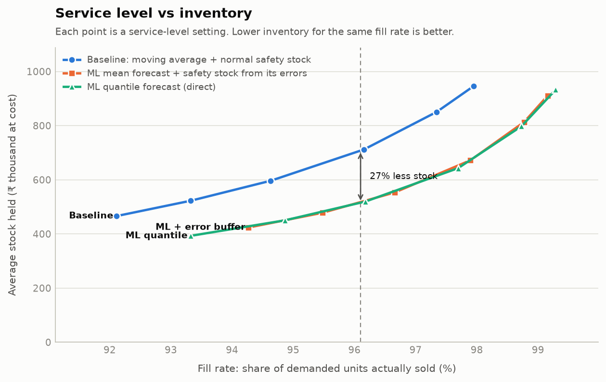
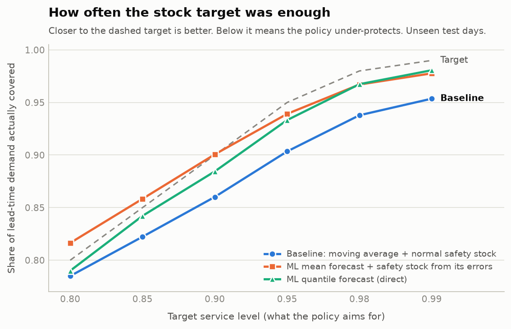
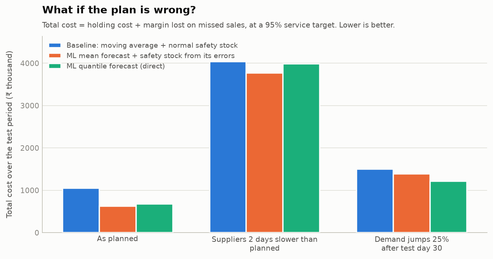
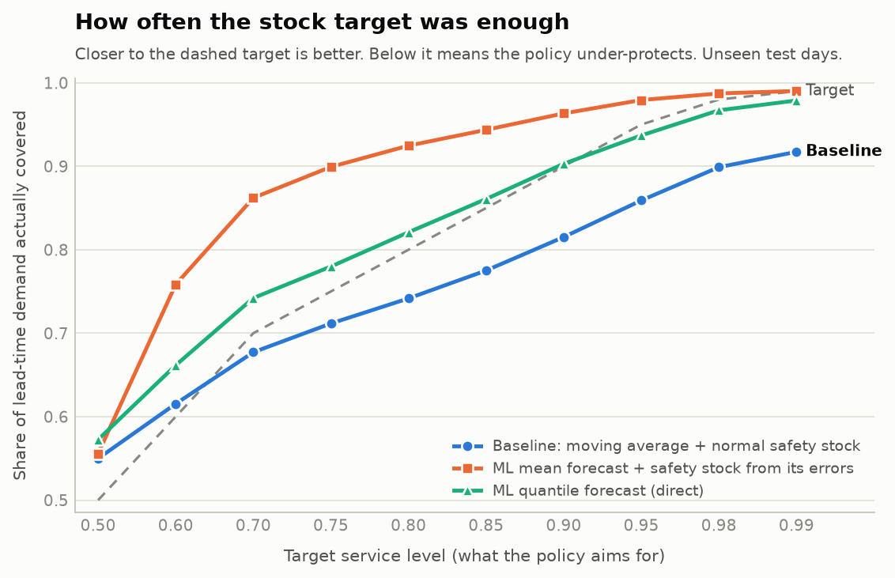
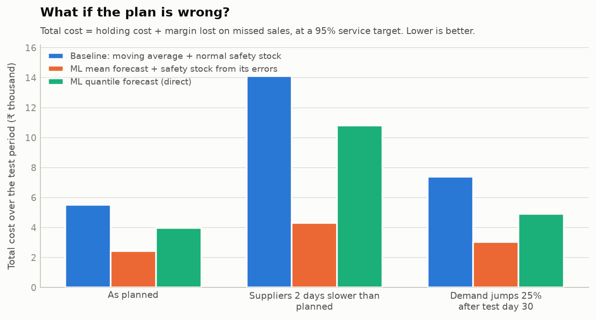

```markdown
# From Forecast to Stock Decision: Cutting Inventory Without Losing Sales

A retail demand-forecasting model is only useful if it changes how much stock you order.

This project connects **demand forecasting to inventory decisions**. It forecasts demand over each supplier lead time, converts forecasts into order-up-to stock levels, and simulates inventory decisions on days the model has never seen.

The project supports both:

- **Synthetic retail data** for a fast, reproducible end-to-end experiment.
- **Real Walmart M5 sales data** to test the same approach on real-world demand data.

---

# The Business Question

A retailer has to order stock before customers buy it.

Too little inventory leads to stock-outs and lost sales. Too much inventory ties up cash and increases holding costs.

**How much stock is needed to achieve a target service level, and can better demand forecasts improve the inventory decision?**

---

# What This Project Does

## 1. Forecast Demand

The model predicts the units each product will sell during its supplier lead time.

It uses only information available at the time of the inventory decision, including historical sales and, for the synthetic dataset, the planned promotion calendar.

Two ML forecasting approaches are used:

- **Mean forecast** — predicts expected demand.
- **Quantile forecast** — predicts upper demand levels from 80% to 99%.

## 2. Convert Forecasts Into Stock Decisions

The forecasts are converted into an order-up-to inventory target using three policies:

- **Baseline**  
  A 28-day moving average multiplied by lead time, plus normal-distribution safety stock.

- **ML + error buffer**  
  ML mean forecast plus safety stock calculated from the model's validation errors.

- **ML quantile**  
  A direct upper-quantile ML forecast used as the stock target.

## 3. Simulate Inventory

The simulator runs daily inventory operations across unseen test days, including:

- Orders
- Supplier deliveries
- Available inventory
- Customer demand
- Lost sales from stock-outs
- Holding costs
- Lost margin

## 4. Compare Business Outcomes

The policies are compared using:

- Fill rate
- Stock-out rate
- Average inventory value
- Holding cost
- Lost margin
- Total cost

The project also stress-tests the policies when suppliers are delayed or demand suddenly increases.

---

# Results

## Synthetic Data Experiment

The main synthetic experiment uses:

- **60 products**
- **900 days of sales history**
- Time-based train, validation, and test splits
- **198 completely unseen test days**

> **Important:** The synthetic results demonstrate how the forecasting and inventory pipeline works. They should not be interpreted as a guarantee of similar savings in a real business.

---

## 1. Same Service Level With Less Inventory



At similar fill rates, both ML policies required substantially less inventory than the simple moving-average baseline.

For example, around a **96% fill rate**, the experiment showed approximately:

| Policy | Average Inventory Value |
|---|---:|
| Baseline | ₹7.1 lakh |
| ML + error buffer | ₹5.2 lakh |
| ML quantile | ₹5.2 lakh |

This represents roughly **27% less inventory** while maintaining a similar service level.

The key point is that better forecasting becomes useful when it is translated into an actual inventory decision.

---

## 2. Results at a 95% Service Target

| Policy | Fill Rate | Avg. Inventory Value | Holding Cost | Lost Margin | Total Cost |
|---|---:|---:|---:|---:|---:|
| Baseline | 96.2% | ₹7.12 lakh | ₹0.90 lakh | ₹9.61 lakh | ₹10.51 lakh |
| ML + error buffer | 97.9% | ₹6.72 lakh | ₹0.85 lakh | ₹5.37 lakh | ₹6.21 lakh |
| ML quantile | 97.7% | ₹6.43 lakh | ₹0.81 lakh | ₹6.00 lakh | ₹6.81 lakh |

In this synthetic run, the ML policies achieved higher fill rates with lower average inventory than the baseline.

The **ML + error buffer** policy produced the lowest total cost in this experiment.

---

## 3. How Often Was the Stock Target Enough?



A policy aiming for a particular service level should cover demand approximately that often.

| Metric | Baseline | ML + Error Buffer | ML Quantile |
|---|---:|---:|---:|
| WAPE for mean forecast | 23.0% | 19.0% | n/a |
| Pinball loss at 95% quantile | 1.81 | 1.21 | 1.23 |
| Coverage when targeting 95% | 90.3% | 93.9% | 93.3% |
| Coverage when targeting 99% | 95.4% | 97.8% | 98.1% |

The baseline consistently under-protects inventory at higher service targets.

Both ML approaches produce stock targets closer to the intended service level, although they do not perfectly match every target.

---

## 4. What If the Plan Is Wrong?



The policies were tested under three scenarios at a 95% service target:

| Scenario | Baseline Total Cost | ML + Error Buffer | ML Quantile |
|---|---:|---:|---:|
| As planned | ₹10.51 lakh | ₹6.21 lakh | ₹6.81 lakh |
| Suppliers 2 days slower | ₹40.34 lakh | ₹37.67 lakh | ₹39.82 lakh |
| Demand jumps 25% | ₹15.00 lakh | ₹13.85 lakh | ₹12.15 lakh |

The stress test highlights an important limitation:

**Better demand forecasting cannot fully compensate for unreliable suppliers.**

When deliveries are delayed, all policies experience a significant decline in service performance. In a real implementation, lead-time variability should also be included when calculating safety stock.

---

# Real-World Experiment: Walmart M5 Dataset

The same pipeline can also be run using the **Walmart M5 Forecasting - Accuracy** dataset.

For the M5 experiment:

- One Walmart store was selected.
- **60 high-selling items** were used.
- The data was split chronologically into training, validation, and test periods.
- The final test period contained approximately **11,500 unseen observations**.

---

## What Changed on Real Data?

The M5 experiment produced more mixed results than the synthetic experiment.

The simple baseline achieved a lower mean-forecast WAPE than the ML mean model in this run:

| Metric | Baseline | ML + Error Buffer |
|---|---:|---:|
| WAPE | 27.4% | 34.2% |

However, the ML policies provided stronger protection against stock-outs at many service settings.

At a nominal 95% target:

| Policy | Fill Rate | Avg. Inventory Value | Total Cost |
|---|---:|---:|---:|
| Baseline | 94.5% | ₹3.20 thousand | ₹5.50 thousand |
| ML + error buffer | 99.3% | ₹14.76 thousand | ₹2.42 thousand |
| ML quantile | 98.0% | ₹20.05 thousand | ₹3.98 thousand |

This highlights an important trade-off:

- The **ML + error buffer policy achieved much higher service levels**, but required considerably more inventory.
- The **baseline used less inventory**, but experienced more stock-outs.
- The **ML quantile policy produced mixed results** depending on the service target.

---

## M5 Calibration



The ML policies generally produced coverage closer to high service targets than the baseline.

At higher targets, the baseline continued to under-cover demand, while the ML approaches were more conservative.

---

## M5 Sensitivity Tests



The M5 experiment reinforces another important business finding:

**Supplier delays can reduce the benefits of better forecasting.**

When lead times increased by two days, costs increased significantly for every policy.

---

# What I Learned

Running the same inventory pipeline on both synthetic and real data produced an important lesson:

> **A better forecasting model does not automatically mean lower inventory.**

A forecasting model can be more conservative and achieve higher service levels by holding significantly more stock.

The real business objective is therefore not just minimizing forecast error. It is finding the best balance between:

- Inventory investment
- Service level
- Stock-out risk
- Holding cost
- Lost sales

This is why the project evaluates the entire chain:

**Forecast → Stock Target → Inventory Simulation → Business Outcome**

rather than stopping at forecasting accuracy alone.

---

# How It Avoids Data Leakage

The project uses several safeguards to avoid unrealistic forecasting results:

- **Time-based split:** Training data comes first, followed by validation and then completely unseen test data.
- **No future sales information:** Features at decision day `t` use only information available up to that point.
- **Future-data test:** The test suite scrambles future observations and verifies that the model features do not change.
- **Inventory simulation tests:** Known scenarios are used to verify that the simulator handles stock availability and zero-inventory situations correctly.

---

# Honest Limitations

## Synthetic Data

The main headline results use synthetic data.

The synthetic generator includes planned promotions that are available to the ML model but not to the simple baseline. This demonstrates how additional information can improve inventory decisions, but it also means the synthetic performance gap may be larger than on real data.

## Simple Baseline

The baseline uses a 28-day moving average and normal-distribution safety stock.

A stronger benchmark, such as exponential smoothing or a seasonal forecasting model, could reduce the performance gap.

## M5 Assumptions

The M5 dataset provides sales and prices but does not include actual:

- Product costs
- Supplier lead times
- Purchase orders
- Inventory levels

For the M5 experiment, unit costs and lead times are assumptions used to demonstrate the inventory simulation.

These assumptions should not be interpreted as Walmart's actual operating data.

## Simplified Inventory System

The simulator currently assumes:

- Fixed lead times
- Daily ordering
- No minimum order quantities
- No fixed ordering costs
- Lost sales are not backordered
- No customer goodwill cost
- No explicit supplier lead-time variability in the main policy calculation

---

# Run the Project

## Install Dependencies


pip install -r requirements.txt


## Run With Synthetic Data


python run_pipeline.py

This runs the full synthetic experiment and writes tables and charts to:

results/


## Run Tests


python tests/test_pipeline.py


---

# Run It on Real M5 Data

1. Download **M5 Forecasting - Accuracy** from Kaggle.
2. Unzip the dataset.
3. Run:


python run_pipeline.py --data m5 --m5-dir path/to/unzipped --out results_m5

The M5 loader:

- Selects one store (default: `CA_1`)
- Selects high-selling items using only the training portion of the requested date range
- Estimates shelf price and unit cost from historical training prices
- Does not treat realized future prices as known promotions
- Assigns assumed supplier lead times for the inventory simulation

Outputs are written to:

results_m5/

---

# Project Layout

run_pipeline.py
│
├── src/
│   ├── data.py
│   │   └── Synthetic data generator + M5 loader
│   │
│   ├── forecast.py
│   │   └── Features, ML models, baseline and forecast metrics
│   │
│   ├── inventory.py
│   │   └── Daily inventory simulation
│   │
│   └── report.py
│       └── Tables and charts
│
├── tests/
│   └── test_pipeline.py
│       └── Sanity and data-leakage checks
│
├── results/
│   └── Synthetic experiment outputs
│
└── results_m5/
    └── M5 experiment outputs


---

# Ideas to Extend the Project

- Add **lead-time variability** directly to the safety-stock calculation.
- Compare against stronger forecasting baselines such as exponential smoothing.
- Add weekly inventory review cycles and minimum order quantities.
- Segment products using **ABC analysis** and assign different service targets.
- Optimize service levels based on product margin and holding costs.
- Build a **Power BI dashboard** using `policy_curves.csv` so business users can explore the inventory and service-level trade-off.

---

# Key Takeaway

**Forecast accuracy is only the beginning.**

The real value of a demand forecast comes from how it changes an operational decision.

This project connects machine learning forecasting to inventory policy and evaluates the result using business outcomes:

**Inventory → Service Level → Cost**